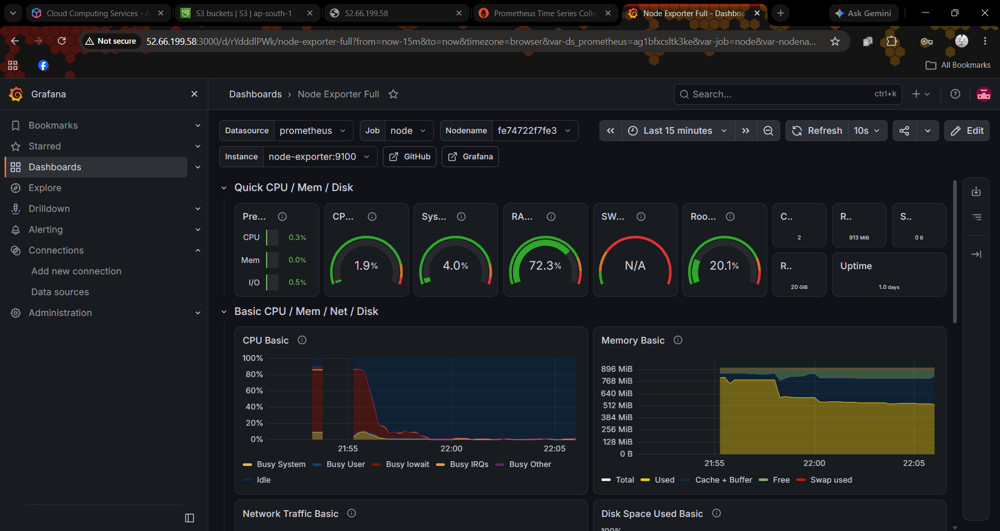
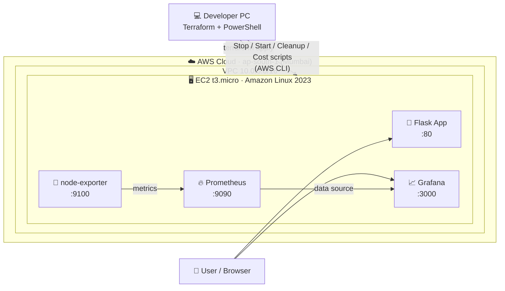
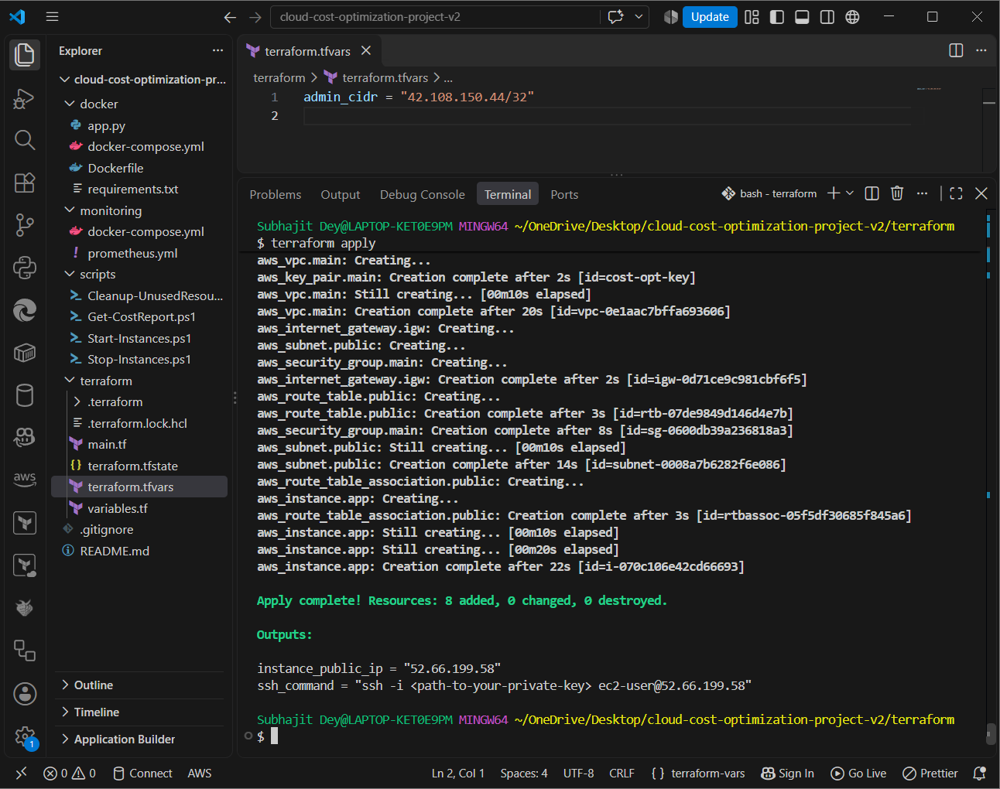
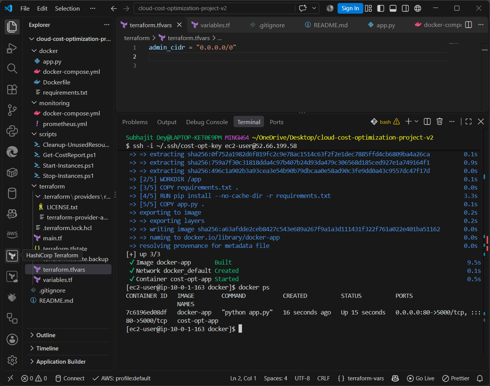
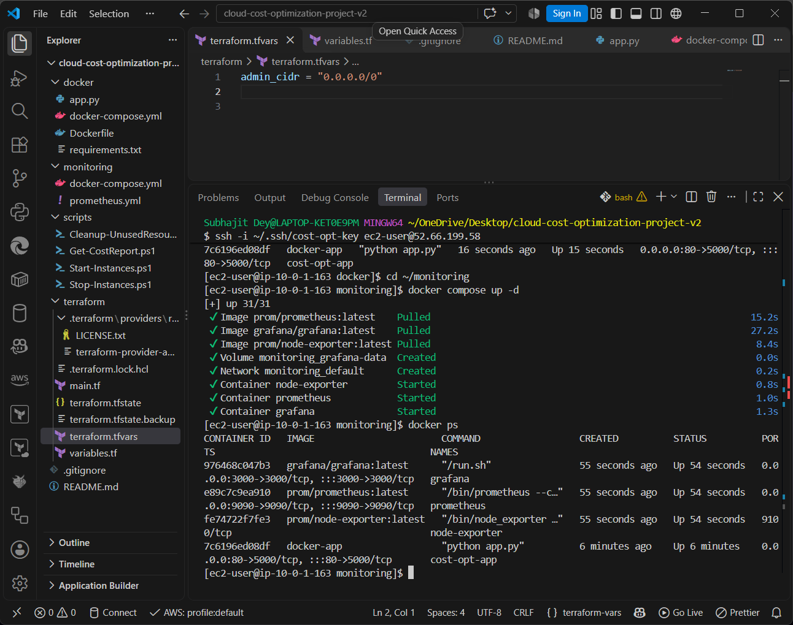
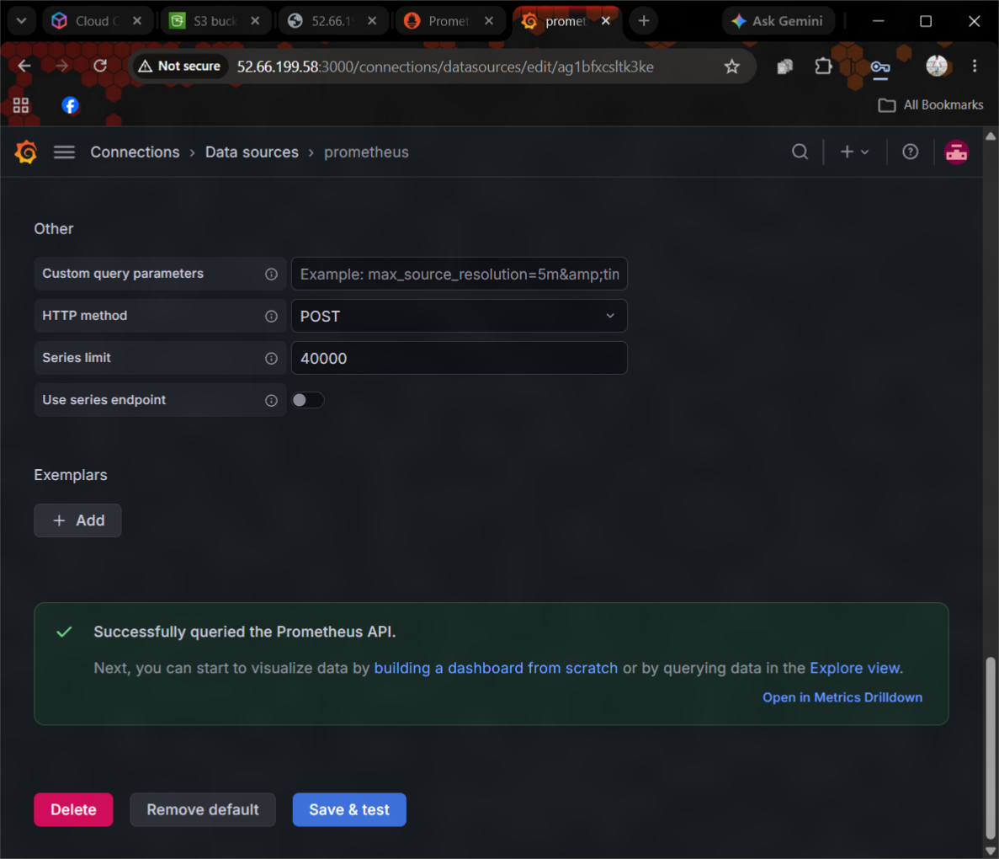
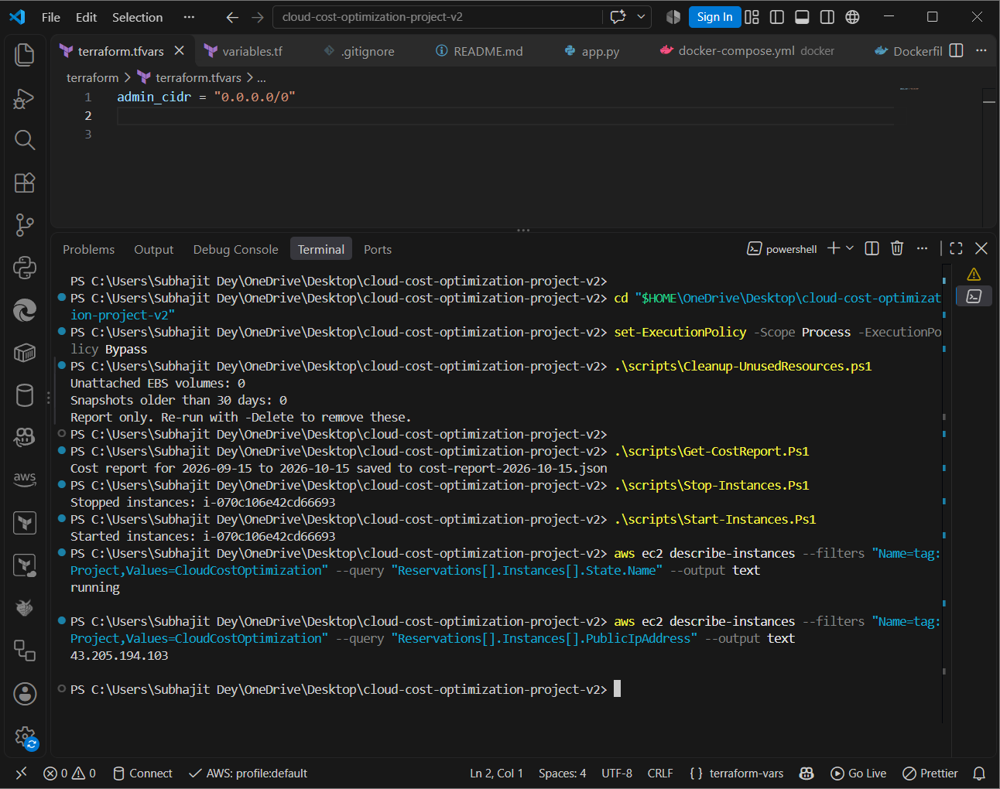
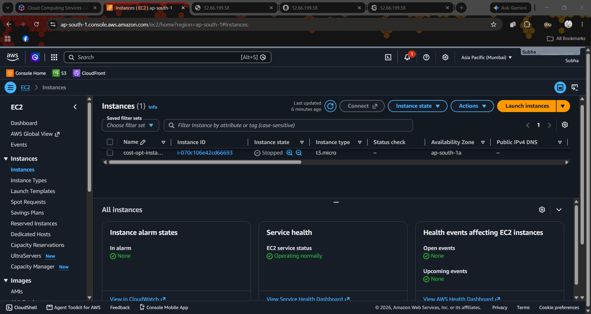
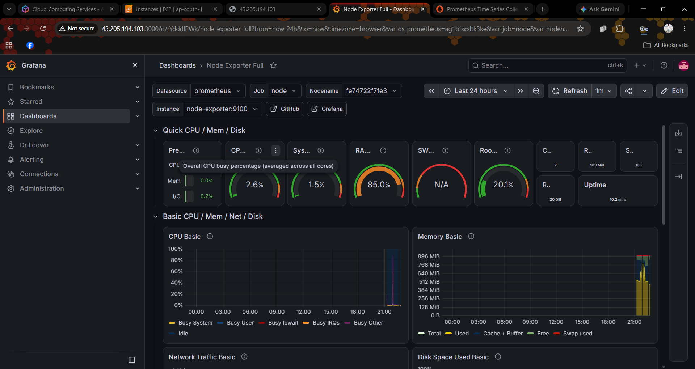

<div align="center">

# ☁️ Cloud Cost Optimization on AWS

### Build it with code. Watch it live. Save money automatically.


<br>



<sub>Live CPU, memory, disk and network metrics of the EC2 server, collected by Prometheus and shown in Grafana.</sub>

</div>

---

## 📖 Table of Contents

- [About the Project](#-about-the-project)
- [Architecture](#-architecture)
- [Tech Stack](#-tech-stack)
- [What Terraform Builds](#-what-terraform-builds)
- [Cost Optimization Automation](#-cost-optimization-automation)
- [Project Gallery](#-project-gallery)
- [Folder Structure](#-folder-structure)
- [Getting Started](#-getting-started)
- [Security Practices](#-security-practices)
- [What I Learned](#-what-i-learned)
- [Future Improvements](#-future-improvements)
- [Author](#-author)

---

## 🎯 About the Project

Cloud bills grow quietly: servers keep running overnight, forgotten disks pile up, and nobody notices until the invoice arrives.

This project tackles that problem end to end:

1. 🏗️ **Provision** the whole AWS environment with **Terraform** (no clicking in the console)
2. 🐳 **Run** a containerized app on EC2 with **Docker**
3. 📊 **Monitor** server usage with **Prometheus + Grafana**
4. ⚡ **Automate** savings with **PowerShell + AWS CLI** scripts that stop idle servers, find unused resources and report costs

> 💡 **Core idea:** a stopped EC2 instance is no longer billed for compute, only for its small disk. Monitoring shows *when* a server is idle, and the scripts act on it.

---

## 🏛️ Architecture



---

## 🛠️ Tech Stack

| Area | Tool | Used for |
|---|---|---|
| ☁️ Cloud | **AWS** (EC2, VPC, IGW, Security Group, EBS, Cost Explorer) | Hosting and billing data |
| 🏗️ IaC | **Terraform** | Creating all infrastructure from code |
| 🐳 Containers | **Docker + Docker Compose** | Running the app and monitoring stack |
| 📊 Monitoring | **Prometheus, Grafana, node-exporter** | Collecting and visualizing metrics |
| ⚡ Automation | **PowerShell + AWS CLI** | Cost-saving scripts |
| 🐍 App | **Python (Flask)** | Demo web application |

---

## 🏗️ What Terraform Builds

**8 resources, created with one command (`terraform apply`):**

| # | Resource | Purpose |
|---|---|---|
| 1 | VPC | Private network for the project |
| 2 | Internet Gateway | Internet access for the VPC |
| 3 | Public Subnet | Where the server lives |
| 4 | Route Table | Sends internet traffic to the gateway |
| 5 | Route Table Association | Connects the subnet to the route table |
| 6 | Security Group | Firewall: SSH, Grafana and Prometheus only from your IP |
| 7 | Key Pair | SSH login to the server |
| 8 | EC2 Instance | t3.micro, 20 GB gp3 disk, installs Docker and Git on first boot |

Every resource is tagged `Project = CloudCostOptimization`, so the scripts can find them automatically.

---

## ⚡ Cost Optimization Automation

| Script | What it does |
|---|---|
| 🛑 `Stop-Instances.ps1` | Stops all running instances tagged `CloudCostOptimization` |
| ▶️ `Start-Instances.ps1` | Starts them again |
| 🧹 `Cleanup-UnusedResources.ps1` | Finds unattached EBS volumes and old snapshots. **Safe by default:** it only reports unless you add `-Delete` |
| 💰 `Get-CostReport.ps1` | Saves cost per AWS service (last N days) as a JSON report via Cost Explorer |

```powershell
.\scripts\Stop-Instances.ps1                      # save money while idle
.\scripts\Start-Instances.ps1                     # bring the server back
.\scripts\Cleanup-UnusedResources.ps1             # report only
.\scripts\Cleanup-UnusedResources.ps1 -Delete     # actually delete
.\scripts\Get-CostReport.ps1 -Days 30             # cost per service
```

> ℹ️ The server gets a **new public IP** every time it is stopped and started. Always check the new IP before connecting.

---

## 🖼️ Project Gallery

<table>
  <tr>
    <td align="center" width="50%">
      <br>
      <b>1 · Terraform: 8 resources created</b>
    </td>
    <td align="center" width="50%">
      <br>
      <b>2 · App container running on EC2</b>
    </td>
  </tr>
  <tr>
    <td align="center">
      <br>
      <b>3 · Prometheus, Grafana and node-exporter up</b>
    </td>
    <td align="center">
      <br>
      <b>4 · Grafana connected to Prometheus</b>
    </td>
  </tr>
  <tr>
    <td align="center">
      <br>
      <b>5 · PowerShell automation in action</b>
    </td>
    <td align="center">
      <br>
      <b>6 · Instance stopped by the script</b>
    </td>
  </tr>
</table>

<div align="center">

**After restart:** Grafana shows a gap in the graphs for the time the server was stopped.



</div>

---

## 📂 Folder Structure

```
cloud-cost-optimization-aws/
├── terraform/      # VPC, subnet, security group, key pair, EC2 instance
├── docker/         # Flask app, Dockerfile, docker-compose.yml
├── monitoring/     # Prometheus + Grafana + node-exporter (docker-compose)
├── scripts/        # PowerShell: start/stop, cleanup, cost report
├── screenshots/    # Proof of the working project
├── .gitignore      # Keeps secrets and state files out of Git
└── README.md
```

---

## 🚀 Getting Started

### Prerequisites

- An AWS account and an IAM user with access keys
- [AWS CLI](https://aws.amazon.com/cli/), [Terraform](https://developer.hashicorp.com/terraform/downloads), [PowerShell](https://learn.microsoft.com/powershell/) and Git

### 1️⃣ Clone and configure

```bash
git clone https://github.com/subhajitajodhya-dotcom/cloud-cost-optimization-aws.git
cd cloud-cost-optimization-aws
aws configure
```

### 2️⃣ Create an SSH key

```bash
ssh-keygen -t ed25519 -f ~/.ssh/cost-opt-key
```

### 3️⃣ Set your IP (firewall)

Create `terraform/terraform.tfvars` (it is git-ignored):

```hcl
admin_cidr = "YOUR_PUBLIC_IP/32"
```

### 4️⃣ Deploy the infrastructure

```bash
cd terraform
terraform init
terraform plan
terraform apply
```

Terraform prints the server's public IP when it finishes.

### 5️⃣ Start the app and monitoring

```bash
scp -i ~/.ssh/cost-opt-key -r docker monitoring ec2-user@<PUBLIC_IP>:~
ssh -i ~/.ssh/cost-opt-key ec2-user@<PUBLIC_IP>

cd docker && docker compose up -d --build
cd ../monitoring && docker compose up -d
```

### 6️⃣ Open it in your browser

| Service | URL |
|---|---|
| 🐍 App | `http://<PUBLIC_IP>` |
| 🔥 Prometheus | `http://<PUBLIC_IP>:9090` |
| 📈 Grafana | `http://<PUBLIC_IP>:3000` (login `admin` / `admin`, then change it) |

In Grafana: add Prometheus as a data source (`http://prometheus:9090`) and import dashboard **1860** (Node Exporter Full).

### 7️⃣ Clean up when you're done

```bash
cd terraform
terraform destroy
```

> ⚠️ Always run `terraform destroy` after testing so AWS stops charging you.

---

## 🔐 Security Practices

- ✅ `terraform.tfstate`, `terraform.tfvars`, `.terraform/` and cost reports are in `.gitignore` and never committed
- ✅ Firewall rules for SSH, Grafana and Prometheus allow **only your IP** (`admin_cidr`)
- ✅ No AWS access keys or SSH private keys are stored in the repo
- ✅ The cleanup script is **report-only by default**
- ⚠️ Change the default Grafana password (`admin` / `admin`) on first login

---

## 📚 What I Learned

- 🏗️ Writing a full AWS network and server setup as repeatable Terraform code
- 🐳 Running multi-container apps with Docker Compose, and fixing real problems like the missing `buildx` plugin on Amazon Linux 2023
- 📊 Collecting and visualizing server metrics with Prometheus and Grafana
- ⚡ Automating AWS tasks with PowerShell and the AWS CLI
- 💰 How cloud billing works, and how stopping idle resources and removing leftovers cuts cost
- 🔥 Debugging real issues: firewall (security group) timeouts, changing public IPs, and Terraform state

---

## 🔮 Future Improvements

- [ ] Run the stop/start scripts automatically on a schedule (for example, stop at night)
- [ ] Add Grafana alerts for idle or overloaded servers
- [ ] Store Terraform state remotely in S3
- [ ] Add an Elastic IP so the address does not change
- [ ] Add AWS Budgets alerts

---

## 👨‍💻 Author

**Subhajit Dey**

[](https://github.com/subhajitajodhya-dotcom)

---

<div align="center">

⭐ **If you found this project useful, please give it a star!** ⭐

*Built with curiosity, hands-on practice and a passion for cloud engineering.*

</div>
